<p align="center"></p>
<h1 align="center">KWS · Quản lý kho</h1>
<p align="center">Nhập hàng · Xuất hàng · Tồn kho · Báo cáo</p>
<p align="center">


</p>
<p align="center">Python / Tkinter · FastAPI · PostgreSQL · SQLite · SQLAlchemy · Nginx</p>

**[Tải mã nguồn ZIP](https://github.com/KyotaFill/KWS/archive/refs/heads/main.zip)** · **[Sơ đồ PDF](03_So_do/Hien_hanh/KWS_Hien_hanh.pdf)** · **[Sơ đồ draw.io](03_So_do/Hien_hanh/KWS_Hien_hanh.drawio)** · **[Hướng dẫn chạy](01_Tai_lieu/CAI_DAT.md)**

Giao diện KWS dùng xanh lá làm màu chủ đạo, với footer xanh đậm và trạng thái chọn đồng bộ trên thanh điều hướng, tab và bảng dữ liệu.

KWS là ứng dụng quản lý kho desktop theo mô hình máy khách – máy chủ. Nhân viên thao tác trên giao diện Tkinter; máy chủ FastAPI kiểm tra quyền, phê duyệt và ghi sổ vào PostgreSQL. Dữ liệu nháp và yêu cầu cần phục hồi được lưu cục bộ bằng SQLite. Chứng từ đã ghi sổ có dấu vết người thực hiện và kết quả giao dịch để tra cứu.

KWS được tách từ WMS và tập trung vào hàng thuộc doanh nghiệp. Bản này có 10 nhóm chức năng chính và 2 tiện ích kết nối/phục hồi. Không có màn hình ký gửi, bảo hành, trường mở rộng, soạn/đóng kiện, kiểm định, cất/di chuyển, chuyển kho, trả hàng, kiểm kê/điều chỉnh, đảo giao dịch hoặc nhập tệp hàng loạt.

## Công nghệ và kiến trúc

| Thành phần | Công nghệ | Trách nhiệm |
|---|---|---|
| Desktop | Python 3.12+, Tkinter/ttk, Pillow | Biểu mẫu, bảng dữ liệu, tìm kiếm, quét mã, phân trang, giao diện sáng/tối |
| HTTP API | FastAPI, Pydantic, Uvicorn, HTTPX | Hợp đồng dữ liệu, xác thực, kiểm tra nghiệp vụ và phân quyền |
| Dữ liệu chính thức | PostgreSQL 15+, SQLAlchemy 2, psycopg 3 | Giao dịch, số dư, sổ kho, khóa cạnh tranh, audit, outbox, ACK |
| Dữ liệu trên máy khách | SQLite, keyring | Nháp và nhật ký yêu cầu; token ghi nhớ phiên nằm trong kho bí mật hệ điều hành |
| Bảo mật | Argon2, Fernet, TOTP | Băm mật khẩu, bảo vệ khóa MFA, xác thực và thu hồi phiên |
| Báo cáo và in | CSV/XLSX, ReportLab, pypdfium2 | Snapshot báo cáo, kết xuất tệp, tạo PDF, xem trước và in |
| Triển khai LAN | Nginx, systemd | HTTPS, proxy API, giám sát tiến trình |
| Kiểm thử | pytest, PostgreSQL tạm, Xvfb | Kiểm tra nghiệp vụ, API, giao diện và lỗi cạnh tranh |

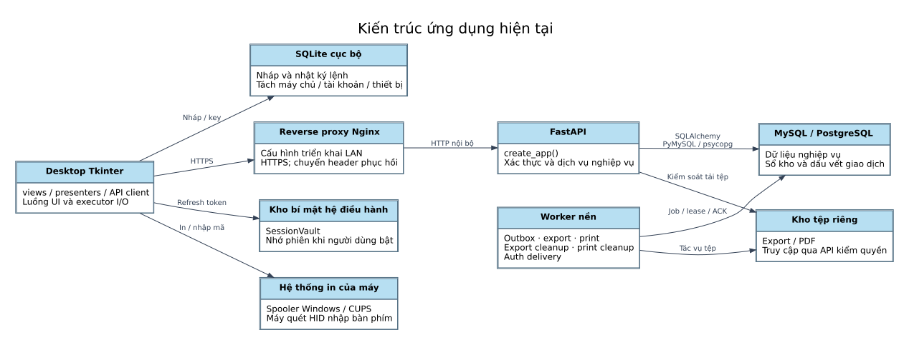

Desktop không kết nối trực tiếp PostgreSQL. Mỗi lệnh ghi được kiểm tra quyền hiện tại, phạm vi kho, phiên bản chứng từ và khóa chống trùng. Thay đổi sổ, số dư, giữ chỗ, audit và ACK được ghi trong cùng giao dịch. Worker xử lý xuất tệp và PDF ngoài giao dịch ghi sổ.

## Luồng nghiệp vụ

1. **Thiết lập:** tạo tài khoản, quyền và danh mục; chuẩn bị kho, vị trí lưu trữ, đơn vị, hàng hóa, đối tác và kỳ ghi sổ.
2. **Tồn đầu kỳ:** khai báo lượng thực tế và biên bản, gửi duyệt, ghi nhận vào kho trước khi vận hành.
3. **Nhập hàng:** lập đơn mua, phê duyệt đơn, lập phiếu nhận, duyệt phiếu và ghi lượng thực nhận thẳng vào vị trí `STORAGE`. Có thể nhận từng phần; không được vượt lượng còn lại của đơn.
4. **Xuất hàng:** lập và duyệt đơn bán, lập và duyệt phiếu xuất, giữ lượng khả dụng, sau đó ghi sổ xuất trực tiếp. Không qua bước soạn hàng hay đóng kiện.
5. **Theo dõi:** xem tồn, thẻ kho, nhập/xuất, nhu cầu giữ hàng, hạn dùng và hoạt động; xuất CSV/XLSX hoặc in chứng từ/tem.

Số lượng dùng số thập phân chính xác. Có kiểm tra lô, serial và hạn dùng trong nhập/xuất; tra cứu bảo hành không thuộc KWS. Hàng hết hạn không được nhập vào vị trí lưu trữ hay xuất bán. Chức năng báo cáo không tự thay đổi tồn.

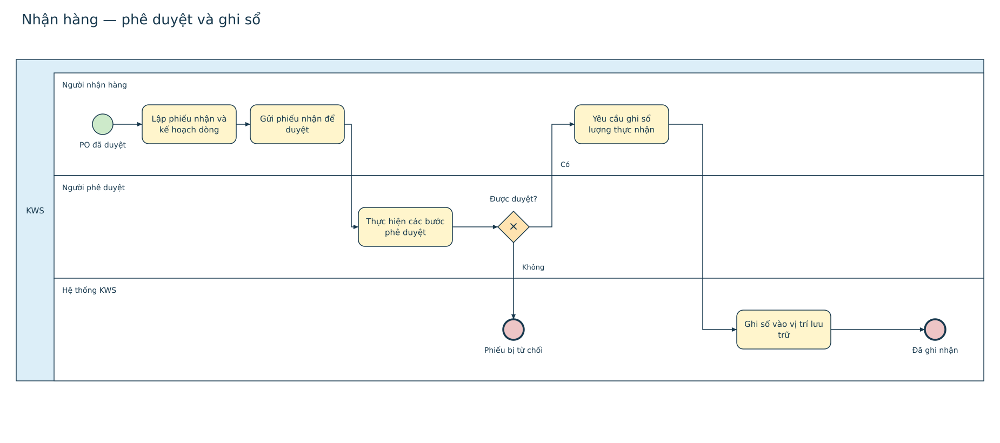
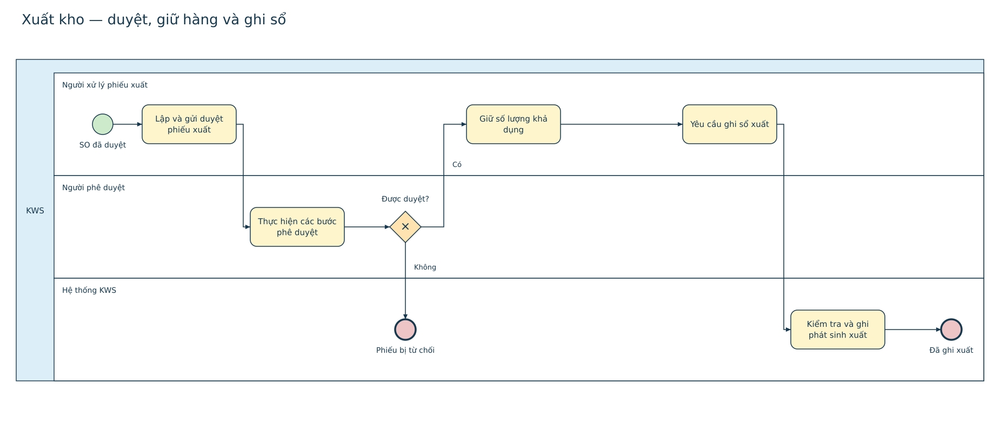

## Chức năng và ảnh giao diện

Ảnh dưới đây được chụp từ KWS đang chạy với API thật và PostgreSQL tạm của bộ kiểm thử. Dữ liệu trong ảnh là dữ liệu kiểm thử, không phải dữ liệu vận hành. [Danh sách ảnh và SHA-256](assets/readme/screenshots.json).

### Đăng nhập

Đăng nhập bằng tài khoản, xác thực MFA khi được yêu cầu, quản lý phiên và đăng xuất. Cấu hình đăng nhập Google hoặc xác minh liên hệ cần nhà cung cấp tương ứng; ứng dụng không mặc định có những dịch vụ này.

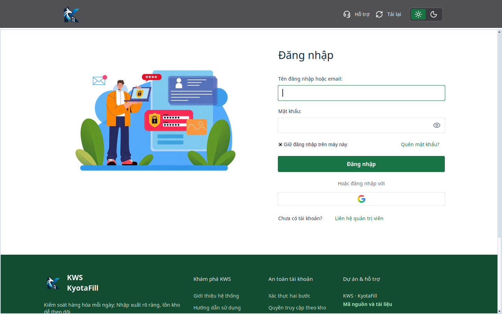

### Kho đang quản lý

Chọn kho được cấp quyền; tải lại quyền, chỉnh hồ sơ, đổi mật khẩu và quản lý MFA. Kho đang chọn được truyền vào các màn hình nghiệp vụ.

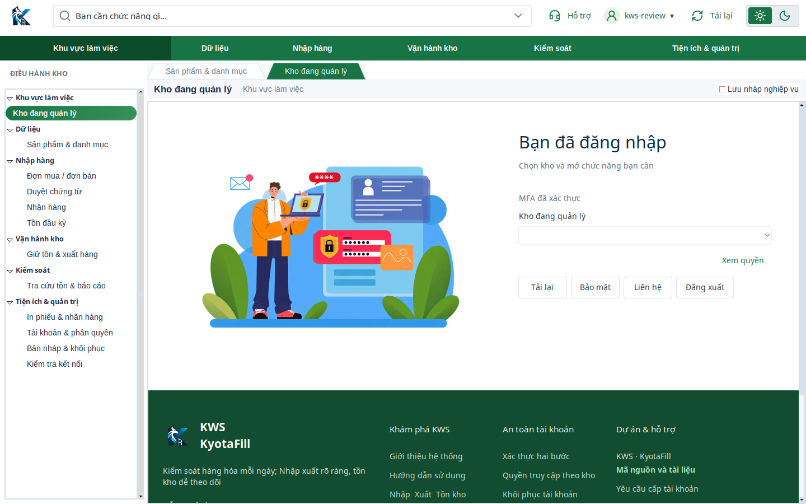

### Sản phẩm & danh mục

Quản lý sản phẩm, nhóm hàng, đơn vị, đối tác, kho và vị trí. Có ảnh/mô tả sản phẩm, quy đổi đơn vị, barcode và giá tham chiếu theo quyền. Đơn vị cơ sở và cách theo dõi không được đổi sau phát sinh.

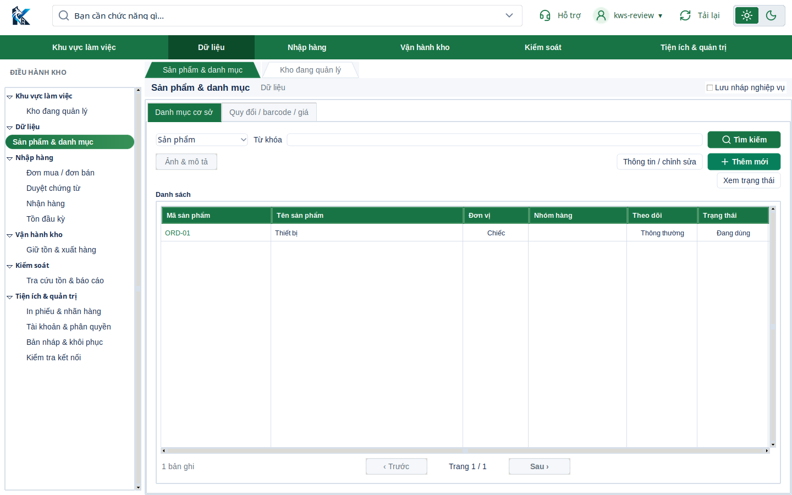

### Đơn mua / đơn bán

Lập đơn mua PO và đơn bán SO, sửa nháp, gửi duyệt, theo dõi phần đã thực hiện/còn lại, hủy hoặc đóng phần còn lại theo trạng thái. Chỉnh chứng từ đã duyệt phải đưa về quy trình duyệt phù hợp.

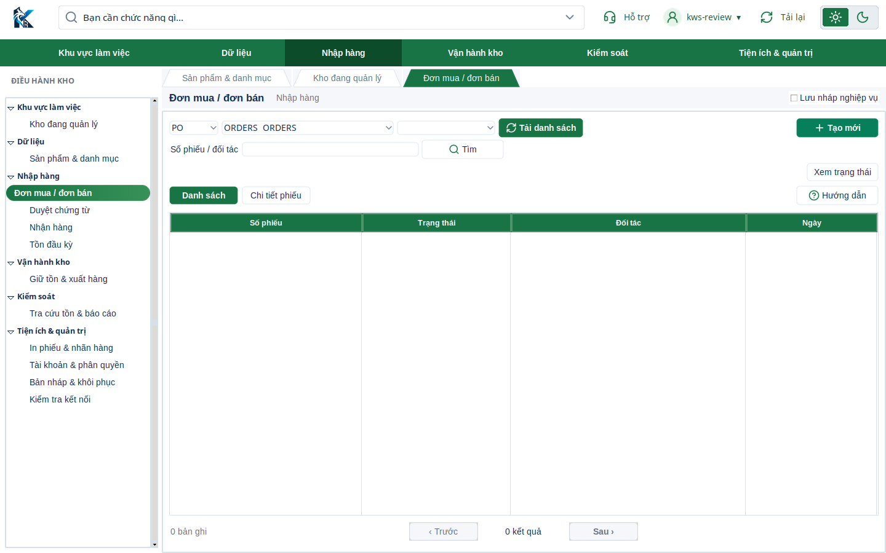

### Duyệt chứng từ

Danh sách yêu cầu theo quyền và kho; xem dòng hàng, lý do và nội dung trước quyết định. Máy chủ áp dụng các bước duyệt và tách nhiệm vụ; người lập không tự duyệt phiếu của mình.

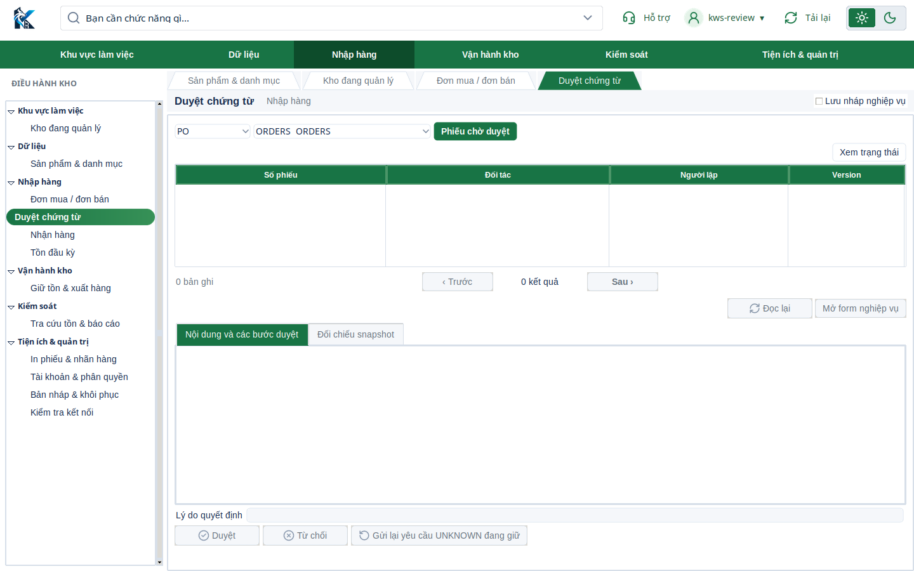

### Nhận hàng

Chọn PO đã duyệt, lập kế hoạch nhận và vị trí lưu trữ, nhập lô/serial khi mặt hàng yêu cầu. Sau duyệt, ghi lượng thực nhận một lần hoặc từng phần. Hàng được nhập thẳng vào STORAGE.

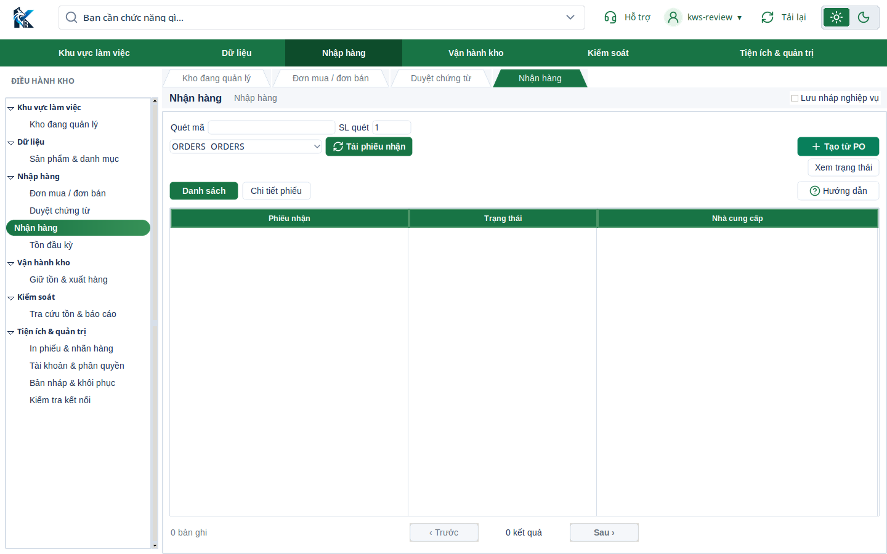

### Tồn đầu kỳ

Khai báo tồn đầu kỳ hàng doanh nghiệp, ngày nghiệp vụ, biên bản và dòng hàng theo vị trí. Có duyệt độc lập và khóa khởi tạo để không ghi chồng lên kho đã vận hành.

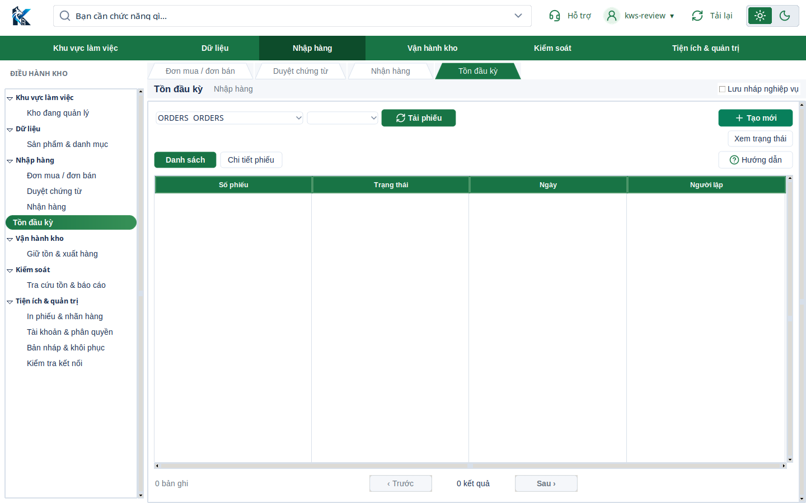

### Giữ tồn & xuất hàng

Chọn SO đã duyệt, lập phiếu xuất, phê duyệt, giữ nguồn tồn và ghi xuất từ lượng đã giữ. Không xuất vượt tồn, lượng giữ hoặc lượng đơn còn lại; thao tác đồng thời được khóa tại máy chủ.

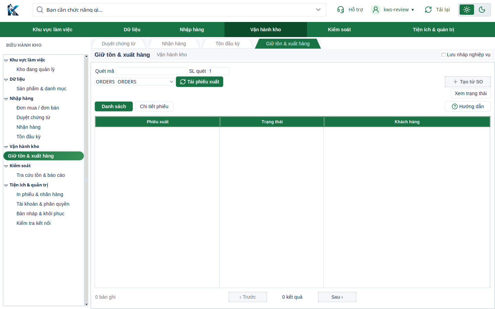

### Tra cứu tồn & báo cáo

Sáu báo cáo: R01 tồn theo vị trí, R02 nhập/xuất, R03 thẻ kho, R04 giữ hàng/nhu cầu mở, R06 hạn dùng/tồn lâu, R08 hoạt động/giá tham chiếu. Snapshot giữ dữ liệu nhất quán khi phân trang; xuất CSV/XLSX có kiểm tra lại quyền.

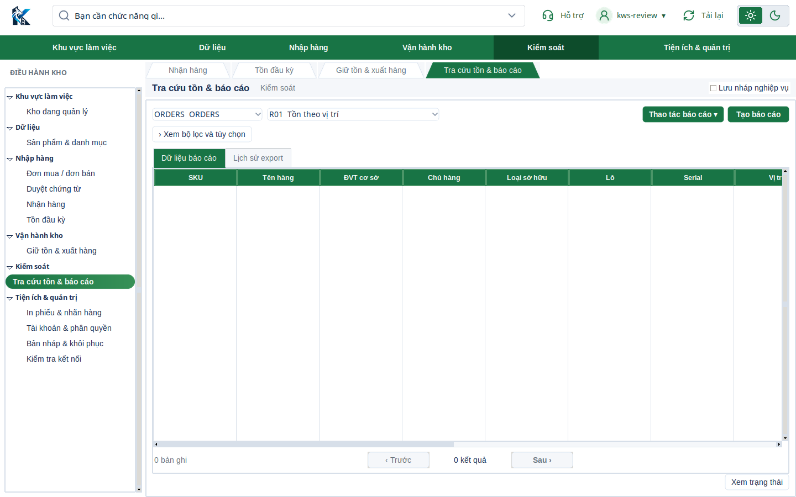

### In phiếu & nhãn hàng

Tạo PDF cho phiếu nhập, phiếu xuất, tem sản phẩm/serial và tem vị trí. Khung xem trước mở khi chọn In/xem trước. Chọn máy in, số bản, lưu PDF, theo dõi trạng thái và in lại từ menu thao tác.

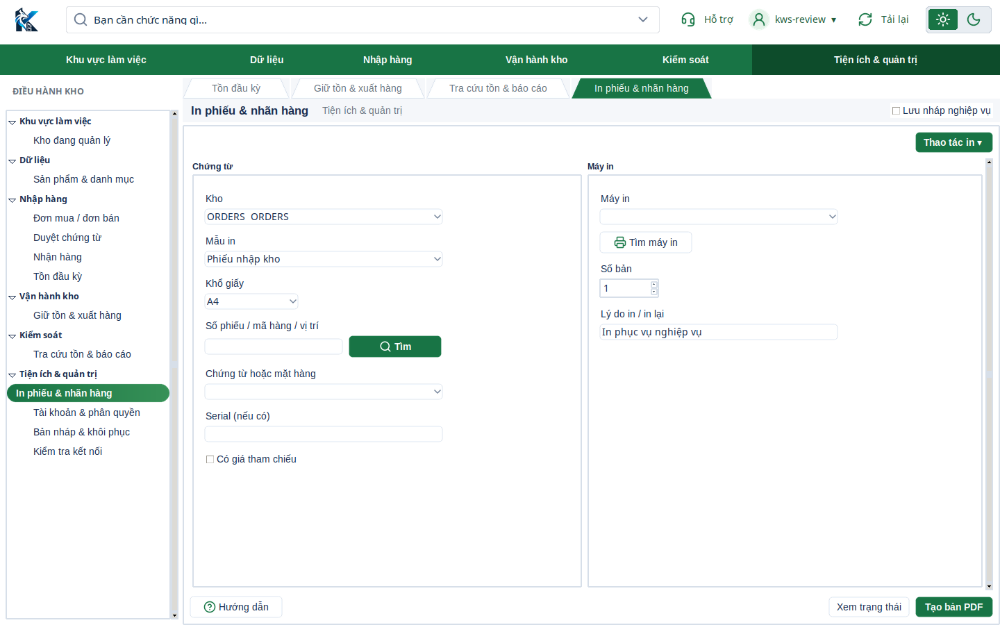

### Tài khoản & phân quyền

Tạo và khóa/mở tài khoản, thu hồi phiên, yêu cầu cấp quyền theo kho và duyệt cấp quyền. Quyền đặc biệt có yêu cầu MFA và kiểm tra độc lập ở máy chủ.

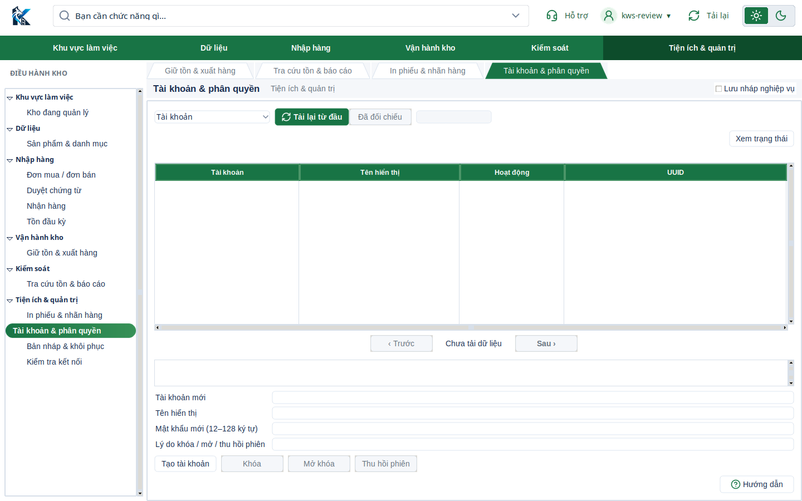

### Bản nháp & khôi phục

Xem nháp hoặc lệnh mất phản hồi, tra ACK trước khi quyết định gửi lại. Gửi lại giữ nguyên khóa và nội dung, không tự ghi sổ lúc mở ứng dụng.

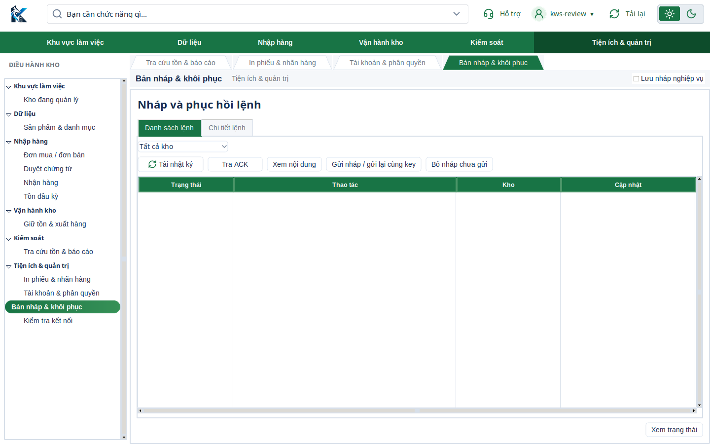

### Kiểm tra kết nối

Kiểm tra API và trạng thái sẵn sàng của cơ sở dữ liệu. Nút Tải lại khởi động lại ứng dụng; khi thoát có xác nhận và chờ worker kết thúc.

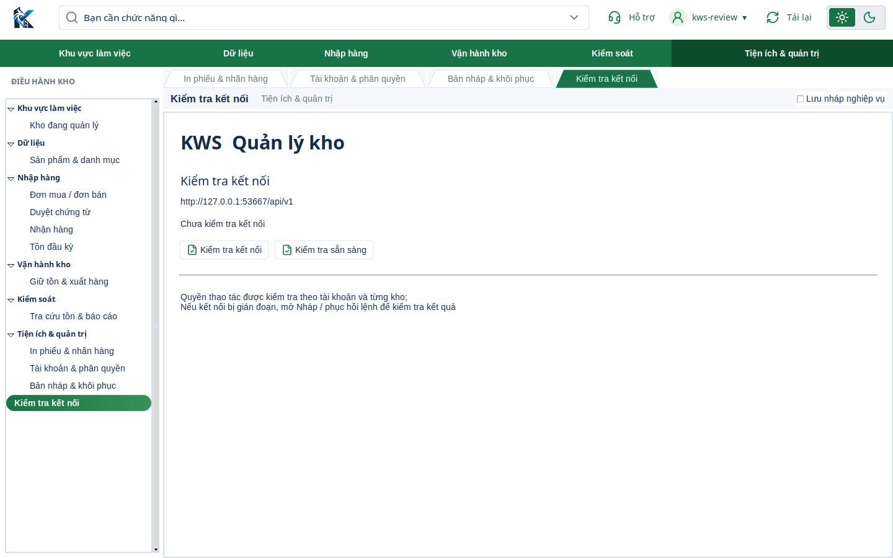

## Chạy và tải ứng dụng

Repository hiện cung cấp mã nguồn và cấu hình đóng gói. Liên kết tải ZIP ở đầu trang tải nhánh `main`; chưa có bộ cài KWS phát hành đã ký. Không dùng bộ cài WMS để chạy bản KWS này.

```bash
python3 -m venv .venv
source .venv/bin/activate
python -m pip install -r requirements-app-lock.txt
python -m pip install -e '.[server,desktop,dev]'
```

Sau khi thiết lập `KWS_DATABASE_URL` và khóa MFA theo [hướng dẫn cài đặt](01_Tai_lieu/CAI_DAT.md):

```bash
python -m apps.server.infrastructure.migrations
python -m apps.server
# Cửa sổ terminal khác:
python -m apps.desktop
```

Máy khách dùng `KWS_API_URL`; cấu hình và nháp mặc định ở `kws-lan` trong thư mục dữ liệu người dùng. Giao thức KWS, kho token và cấu hình môi trường được tách khỏi WMS. Cài mới dùng cơ sở dữ liệu KWS riêng.

## Tài liệu kỹ thuật

- [Nghiệp vụ và phạm vi KWS](01_Tai_lieu/NGHIEP_VU.md)
- [Cài đặt, cấu hình và worker](01_Tai_lieu/CAI_DAT.md)
- [Danh mục sơ đồ](03_So_do/Hien_hanh/index.md)
- [OpenAPI từ mã chạy](05_API/openapi_runtime.json)
- [Schema PostgreSQL](02_CSDL/current/schema.json)
- [Kết quả kiểm tra](07_Kiem_tra/README.md)

KWS kế thừa migration và lõi giao dịch của WMS; schema nội bộ vẫn tên `wms`, gồm cả cấu trúc lịch sử của các phân hệ đã bỏ. Điều này không đồng nghĩa các phân hệ đó được cung cấp trong API hay giao diện KWS. Bản rút gọn giảm màn hình, route và worker; chưa có phép đo riêng để kết luận tỷ lệ giảm RAM hoặc dung lượng cài đặt.
